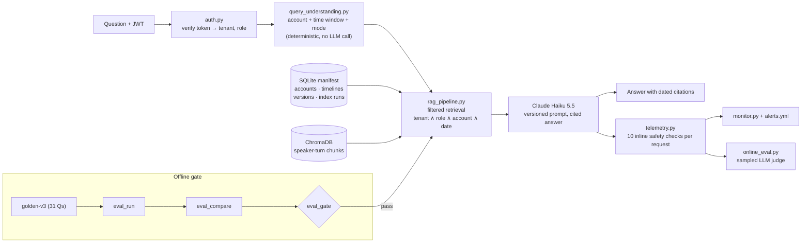

# Transcript Intelligence

**A production-grade RAG system over customer call transcripts. It knows which customer you mean and which point in time you mean, and it never shows you a call your role can't see.**

    

| Retrieval hit@k | Faithfulness | Security violations | Temporal intent accuracy | As-of leakage | Cost / answer | p50 latency |
|:---:|:---:|:---:|:---:|:---:|:---:|:---:|
| **100%** | **98.1%** | **0** | **100%** | **0%** | **$0.0008** | **3.7 s** |

<sub>31-question versioned golden set (`golden-v3`), including 12 account/temporal cases and RBAC leak tests. These are the approved baseline numbers in [`data/evals/baselines/golden-v3.json`](data/evals/baselines/golden-v3.json).</sub>

---

## The problem

Ask a normal RAG bot *"What is Bridgeport's **current** renewal status?"* and it returns whichever call is most semantically similar, which is often an old one whose answer has since changed. It can also mix up two customers with similar names, and it will happily quote a support escalation to a sales rep who shouldn't see it.

This system fixes those three failure modes structurally, with filters enforced at retrieval time rather than by asking the model to behave.

## What makes it different

| | Typical RAG demo | This system |
|---|---|---|
| **Time** | Top-k by similarity | Resolves 10 temporal intents (*latest, as-of, previous call, what changed, full history…*) and enforces date windows as filters. "As of March 1" can never see a March 2 call. |
| **Accounts** | Free-text guess | Stable account IDs derived from customer **email domains**. Look-alikes (Ironclad vs Ironworks) never cross-contaminate. |
| **Access control** | Prompt says "don't reveal" | Tenant + role from a **verified JWT**, AND-ed into every vector query, including neighbour-turn expansion. 6 roles × 7 access levels. |
| **Index updates** | Rebuild everything | Content-hashed, **versioned**, **two-phase commits**. A crash mid-index never serves half-written data; a corrected transcript becomes v2 and v1 is kept for audit. |
| **Evaluation** | Eyeball a few answers | Versioned golden sets, an LLM-graded report, and a **release gate that exits 1** on any regression, leak or stale answer. |
| **Production** | — | Per-request traces, reference-free online judging, monitoring alerts, cost tracking. |

## Architecture



**One pipeline, two callers.** The chatbot and the evaluator call the same `RAGPipeline`, so the offline scores describe exactly what users get. Every trace is stamped with model, prompt version + hash, index version and config.

## Engineering highlights

- **Temporal retrieval** ([docs/temporal.md](docs/temporal.md)). For "latest" questions it pulls a semantic pool, groups it by meeting, and treats the **newest meeting within 15 relevance points of the best** as authoritative. Other modes are as-of, exact period, previous call, comparison, full history, specific meeting and specific revision. The parser also knows that "the March outage" names an event, not a date filter.
- **Failure-safe indexing.** Each revision is marked `pending` → vectors written inactive → switched on → `committed`. A crash at any point leaves the previous revision serving, and the next run resumes the job. Changing chunking, PII or RBAC-tagging rules produces a new fingerprint and re-embeds automatically. Changing the embedding model is refused, because you can't mix vector spaces in one collection.
- **Security** ([docs/security.md](docs/security.md)). The JWT is checked for signature, expiry, issuer, audience, required claims and known role. The tenant can't be overridden from the CLI, a placeholder secret is refused outside dev mode, and `--reset` is scoped to a single tenant. PII is scrubbed before embedding.
- **Evaluation & monitoring** ([docs/monitoring.md](docs/monitoring.md)). There are three loops: an offline golden-set gate, deterministic checks on every request (tenant/RBAC violation, PII in answer, invalid citation, prompt injection, as-of leakage, account mixing, stale revision, truncation), and a sampled reference-free judge for groundedness and stale-answer detection. Low-scoring live answers feed the next golden-set version.
- **Robustness.** The output budget retries automatically on truncation, a thinking-only response is treated as an error rather than an empty answer, and the grader recovers from malformed JSON.
- **94 tests**, including crash-injection during indexing, forged and expired tokens, cross-tenant resets, and the real indexer run on a synthetic dataset with late-arriving and corrected transcripts.

## Quick start

```bash
cp .env.example .env              # add ANTHROPIC_API_KEY and OPENAI_API_KEY (embeddings)
docker compose build
docker compose run --rm rag-index python -m src.rag_index --tenant aegis   # build the index
docker compose run --rm rag python -m src.rag_chat --email vanessa.cruz@aegis.com   # chat as a sales user (dev mode)
```

Try:
```
You: What is Bridgeport's current renewal status?
You: What did we know about Bridgeport as of March 1?
You: What changed since the previous call?
/plan        ← shows how the question was understood: account, window, mode, reasons
/sources     ← chunk ids with meeting date and revision
```

Run the release gate, which is the same check CI would run:
```bash
docker compose run --rm eval-run && docker compose run --rm eval-compare && docker compose run --rm eval-gate
docker compose run --rm test       # 94 tests
```

## Repository map

```
src/
  rag_pipeline.py        shared retrieve → generate pipeline (chat + eval use the same one)
  query_understanding.py account / date / temporal-mode resolution
  rag_index.py           versioned, two-phase, content-hashed indexer
  manifest.py            SQLite source of truth: accounts, timelines, versions, runs
  accounts.py            stable account ids from email domains
  auth.py, roles.py      JWT verification, 6 roles × 7 access levels
  pii_scrub.py           PII removal before embedding
  telemetry.py           per-request traces + inline safety checks
  eval_run / eval_compare / eval_gate.py   offline evaluation + release gate
  online_eval.py, monitor.py               live-traffic judging + alerting
  categorize, sentiment, churn_scorer, action_tracker, topic_analyzer.py   analytics layer
mcp_server/              the analytics exposed as MCP tools for Claude Desktop, with governance + audit log
data/evals/              versioned golden sets + approved baselines
monitoring/alerts.yml    alert rules + release-gate thresholds
docs/                    temporal design, security model, evaluation & monitoring
```

## Also included: the analytics layer

Before the RAG system, the project started as a corpus-analytics pipeline over the same 100 meetings, and it is still part of the repo:

- **Categorization**: hybrid regex + LLM fallback. 91% of meetings are handled by rules for free.
- **Churn-risk scoring**: a 0–100 score with quoted evidence for every account (13 critical, 3 alert, 6 watch, 18 healthy).
- **Action-item tracker**: 397 items parsed into owner, verb and deadline, with workload ranking.
- **Recurring topics**: 47 topics that appear in 3+ meetings, with sentiment correlation. Churn risk and SLA breach are the most negative.
- **MCP server**: `score_churn_risk`, `search_meetings`, `get_sentiment_trends`, `find_recurring_topics` and `get_action_items` as tools in Claude Desktop.

```bash
docker compose run --rm pipeline     # writes outputs/*.csv, *.json and 11 Plotly charts
docker compose up jupyter            # notebooks/analysis.ipynb
```

## Limits and next steps

- Account and date parsing is rule-based, which keeps it fast, free and auditable. An LLM fallback for the cases it can't resolve is the next step, and the live ambiguous-account metric shows when it's needed.
- The manifest is SQLite. In production it would be PostgreSQL, behind a real IdP instead of `auth.py issue`.
- Internal meetings *about* a customer aren't on that customer's timeline yet. Plain account search still finds them.

## Stack

Python 3.10+ · Claude Haiku 5.5 (generation + grading) · OpenAI `text-embedding-3-small` · ChromaDB · SQLite · PyJWT · pandas / Plotly · MCP · Docker Compose · pytest
