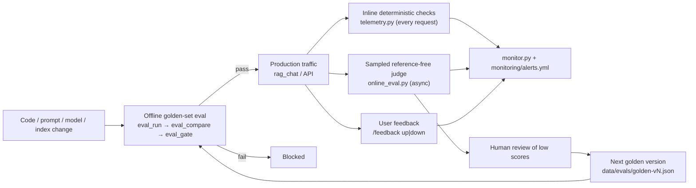

# Evaluation and monitoring

The chatbot and the evaluator share one code path (`src/rag_pipeline.py`), so offline
scores describe what users actually get. Quality is then checked by three loops.



## 1. Offline gate (golden set, has reference answers)

```bash
docker compose run --rm eval-run        # same pipeline as the chatbot; stamps config + versions
docker compose run --rm eval-compare    # hit@k, MRR, faithfulness, correctness, abstention, security, p50/p95, cost
docker compose run --rm eval-gate       # exit 1 = do not deploy
docker compose run --rm eval-gate python -m src.eval_gate --update-baseline   # after a human approves new numbers
```

The gate (`release_gate` in `monitoring/alerts.yml`) fails on: hit@k < 95, faithfulness < 95,
MRR down > 5pp or correctness down > 2pp vs the approved baseline, abstention accuracy < 90,
any grader error, and **any** cross-tenant or RBAC leak. Golden sets are versioned and never
edited in place (`data/evals/README.md`); baselines are kept per version.

## 2. Live traffic (no reference answers)

Every request writes one trace line to `outputs/traces/traces.jsonl`:
request id, tenant, role, hashed user, PII-redacted query and answer, query category,
filters, retrieved chunk ids and scores, index / prompt / embedding / generation versions,
citations, abstained, retrieval and generation latency, tokens, estimated cost, and the
result of these inline checks:

| Check | Severity |
|---|---|
| Chunk from another tenant | page |
| Chunk outside the caller's role | page |
| SSN / card number in the answer | page |
| Email / phone in the answer | warn |
| Answer cites a source number that wasn't in the context | warn |
| Retrieved text contains prompt-injection phrasing | warn |
| Source outside an as-of / period window | warn |
| Another customer's call in an account question | warn |
| Superseded transcript revision used without being asked | warn |

About 10% of requests (`ONLINE_EVAL_SAMPLE_RATE`) plus every flagged request are sampled for
`online_eval.py`. It runs after the user already has the answer, re-fetches the sources by
chunk id, and scores groundedness, citation precision, answer relevance, context relevance,
whether a refusal was correct, and whether injected instructions were followed. These scores
show trends and are not proof that an answer is correct.

```bash
docker compose run --rm online-eval     # schedule hourly
docker compose run --rm monitor         # exit 2 on a page-level alert
```

Account and time handling (latest / as-of / history modes, transcript revisions) is described in
`docs/temporal.md`.

`monitor.py` compares the last 24 h with the previous 7 days, overall and per tenant, role,
query category, temporal mode, model, prompt version and index version, and only fires once a rule's minimum
sample count is met.

## Not built yet

- Shadow / canary deployment and candidate-vs-production comparison need a served API.
- Reformulation-within-5-minutes, citation clicks and escalation signals need a UI.
- Traces are local JSONL; in production they would go to a log pipeline with tenant-separated
  storage and a retention limit.
